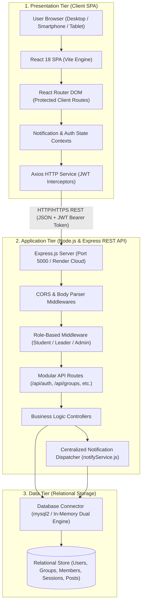
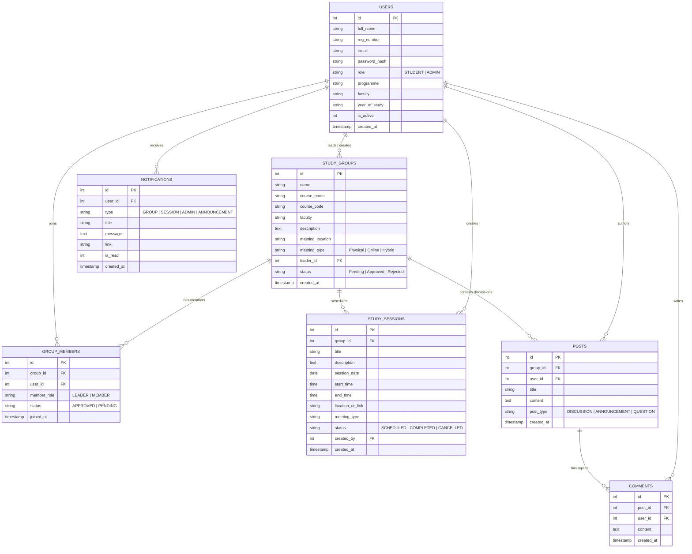
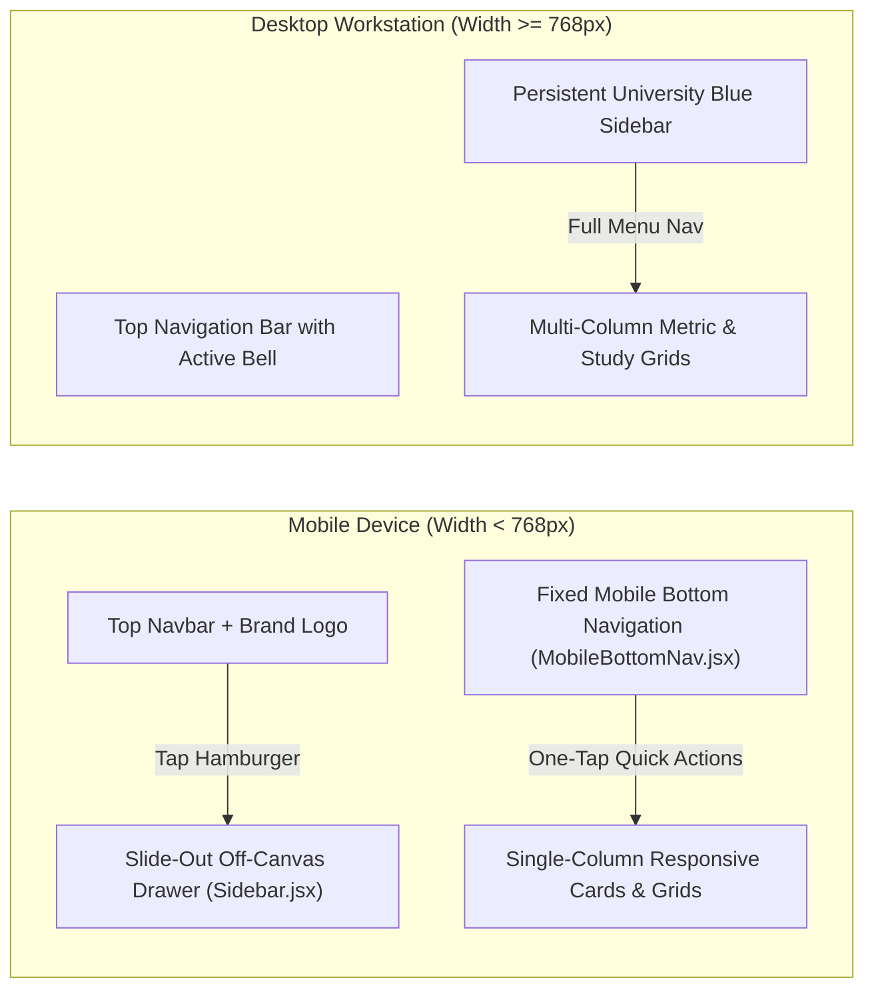

# UGANDA CHRISTIAN UNIVERSITY (UCU)
## FACULTY OF SCIENCE & TECHNOLOGY
### DEPARTMENT OF COMPUTING AND INFORMATICS

---

# COMPREHENSIVE PROJECT REPORT: STUDENT STUDY GROUP FINDER
**An Interactive Collaborative Academic Platform for Peer Learning, Group Moderation, and Study Session Management**

- **Project Title:** Student Study Group Finder (SSGF)
- **Target Institution:** Uganda Christian University (UCU)
- **Course Unit:** Web and Mobile Application Development
- **Lead System Administrator & Developer:** Karongo Shatsi
- **Repository:** [https://github.com/Shatsi-Tech/Student-Study-Group-Finder](https://github.com/Shatsi-Tech/Student-Study-Group-Finder)
- **Live Web Application:** [https://shatsi-tech.github.io/Student-Study-Group-Finder/](https://shatsi-tech.github.io/Student-Study-Group-Finder/)
- **Live Production API:** [https://student-study-group-finder-api.onrender.com](https://student-study-group-finder-api.onrender.com)

---

## TABLE OF CONTENTS
1. [Executive Summary](#1-executive-summary)
2. [Problem Statement & Project Objectives](#2-problem-statement--project-objectives)
3. [System Architecture & Technology Stack](#3-system-architecture--technology-stack)
4. [Database Design & Relational Schema](#4-database-design--relational-schema)
5. [Core System Modules & Functional Capabilities](#5-core-system-modules--functional-capabilities)
6. [Security, Authentication & Authorization](#6-security-authentication--authorization)
7. [Responsive UI & Mobile Experience](#7-responsive-ui--mobile-experience)
8. [Real-Time Notification Infrastructure](#8-real-time-notification-infrastructure)
9. [Verification, Testing & Quality Assurance](#9-verification-testing--quality-assurance)
10. [Deployment & DevOps CI/CD Pipeline](#10-deployment--devops-cicd-pipeline)
11. [Conclusion & Future Enhancements](#11-conclusion--future-enhancements)

---

## 1. EXECUTIVE SUMMARY

The **Student Study Group Finder (SSGF)** is an institutional, multi-tier web application designed specifically for Uganda Christian University (UCU) students and academic administrators. The platform bridges peer collaboration gaps by providing an organized, authenticated ecosystem where students can discover, form, and participate in course-specific study groups, coordinate revision schedules, and engage in academic discussions.

Key highlights of the completed platform include:
- **Administrative Governance:** New study groups created by students require administrative verification and approval, appearing on the administrator review board and upcoming sessions schedule.
- **Peer-to-Peer Study Sessions:** Group leaders can schedule physical or virtual sessions with calendar synchronisation, campus venues, and direct video conference links.
- **Real-Time Notification Engine:** Universal multi-channel notification dispatcher notifying all members across the institution of newly approved groups, revision sessions, announcements, and discussions.
- **Uncapped Member Participation:** Elimination of arbitrary membership caps, allowing study circles to scale dynamically to class-wide revision cohorts.
- **Mobile-First Experience:** Off-canvas drawer navigation, responsive bottom navigation bar, and responsive touch controls tailored for mobile smartphones, tablets, and desktop workstations.

---

## 2. PROBLEM STATEMENT & PROJECT OBJECTIVES

### 2.1 Problem Statement
Higher education institutions like Uganda Christian University host diverse faculties offering rigorous degree and diploma programs. Students frequently encounter hurdles organizing collaborative revision:
1. **Unstructured Communication Channels:** WhatsApp and Telegram groups often suffer from spam, unstructured conversation threads, and lack of accountability.
2. **Siloed Study Efforts:** Commuter students and cross-faculty learners struggle to locate peers taking shared or elective course units (e.g., *BIT3104: Web Systems*, *CSC2101: Data Structures*).
3. **Lack of Institutional Oversight:** University administrators have zero visibility into academic peer learning trends or revision activity.
4. **Disorganized Schedules:** Meeting reminders get buried in casual chat feeds, causing missed study sessions.

### 2.2 Objectives

#### General Objective
To design, implement, test, and deploy a secure, mobile-friendly study group discovery and peer-learning management system for Uganda Christian University.

#### Specific Objectives
1. **User Authentication & Profiles:** Implement dual-credential authentication (institutional email or student registration number) protected with bcrypt password hashing and JSON Web Tokens (JWT).
2. **Automated Group Leadership & Creation:** Enable students to propose study groups for specific course codes with automatic leader assignment upon approval.
3. **Administrative Moderation Board:** Provide designated system administrators with oversight to review, approve, or reject incoming study group proposals and monitor system metrics.
4. **Session Scheduling & Calendar Management:** Allow study group leaders to organize hybrid, virtual, and on-campus revision sessions.
5. **Real-Time Notification Dispatch:** Implement proactive event notifications informing all members of new opportunities, scheduled meetings, and replies.
6. **Responsive Mobile View:** Deliver an accessible, touch-optimized user experience on mobile screens through responsive side drawers and sticky bottom navigation.

---

## 3. SYSTEM ARCHITECTURE & TECHNOLOGY STACK

The platform is built on a decoupled **Three-Tier Client-Server Architecture** utilizing a **RESTful Application Programming Interface (API)**.



### Technology Breakdown

| Layer | Technology | Version | Purpose |
|---|---|---|---|
| **Frontend Framework** | React.js | 18.x | Modular single-page application (SPA) with declarative components |
| **Build Tool** | Vite | 5.x | Ultra-fast HMR and optimized production bundling |
| **Routing** | React Router DOM | 6.x | Client-side routing with role-based Route Guards |
| **Icons & Design** | Lucide React | Latest | Clean, vector iconography for touch and desktop displays |
| **Styling** | Custom CSS3 | - | University theme (Navy `#0b3b60`, Gold `#e09f3e`, White), fluid grids, animations |
| **Backend Runtime** | Node.js | 20.x / 26.x | Asynchronous event-driven JavaScript server environment |
| **API Framework** | Express.js | 4.x | RESTful API endpoint routing and middleware chaining |
| **Security / Crypto** | bcryptjs & jsonwebtoken | Latest | Irreversible password hashing (salt rounds: 10) and signed JWT tokens |
| **Database** | MySQL 8.0 & Fallback Store | - | Relational storage with foreign key constraints and ACID guarantees |
| **Hosting** | Render & GitHub Pages | Cloud | Continuous deployment for backend container & static frontend |

---

## 4. DATABASE DESIGN & RELATIONAL SCHEMA

The database adheres to **Third Normal Form (3NF)** to eliminate redundancy and maintain referential integrity.



---

## 5. CORE SYSTEM MODULES & FUNCTIONAL CAPABILITIES

### 5.1 Landing & Brand Identity
- **Uganda Christian University Crest Integration:** Official UCU crest rendered prominently on the welcome screen, login portal, and dashboard banners.
- **Streamlined Navigation:** Direct access to "Sign In" and "Register", adhering to academic usability standards.

### 5.2 User Authentication & Role-Based Access Control (RBAC)
- **Dual Credential Sign-In:** Allows students to log in using either their institutional email (`shatsikarongo55@mail.com`) or university registration number (`UCU/ADM/2024/001`).
- **Role Enforcement:**
  - `STUDENT`: Can search, create groups, join study sessions, and contribute to discussion boards.
  - `LEADER`: Granted to the group creator; allows scheduling sessions, posting announcements, and moderating members.
  - `ADMIN`: Global oversight to review/approve groups, manage user accounts, and examine platform analytics.

### 5.3 Study Group Workflow & Administrative Moderation
1. **Creation:** A student inputs group name, course code, course title, faculty, format (Physical/Online/Hybrid), and meeting venue.
2. **Submission & Approval Lifecycle:** The group is assigned status `'Pending'`.
3. **Admin Dashboard Review:** Administrators view the pending group on the moderation dashboard. Admins can:
   - **Approve:** Activates the group, displays it in public exploration, schedules the inaugural session on the admin dashboard, and broadcasts a notification to all students.
   - **Reject:** Marks the group as rejected with direct feedback notification to the creator.
4. **Uncapped Group Size:** Groups can welcome unlimited participants without artificial member limits.

### 5.4 Study Session Management
- **Scheduling:** Group leaders schedule revision meetups with location (e.g., Hamu Mukasa Library) or meeting links (Zoom/Google Meet).
- **Upcoming Sessions Visibility:** Sessions appear on both the student's personal timetable and the administrative overview.
- **Session Lifecycle:** Sessions transition from `SCHEDULED` to `COMPLETED` or `CANCELLED`.

### 5.5 Collaborative Academic Forum
- **Categorized Posts:** Posts categorized as `Discussion`, `Announcement`, or `Question`.
- **Threaded Commenting:** Real-time peer interactions allowing members to share solutions, revision past papers, and study notes.

---

## 6. SECURITY, AUTHENTICATION & AUTHORIZATION

1. **Password Hashing:** Passwords are never stored in cleartext. Hashed using `bcryptjs` with 10 salt rounds.
2. **Stateless JWT Tokens:** Authentication headers attach `Bearer <JWT_TOKEN>` with strict expiration (7 days).
3. **SQL Injection Defense:** All queries to the relational database use parameterized bindings with placeholder (`?`) parameters.
4. **Data Sanitization:** Trimming of whitespace, upper-casing course codes, and strict route-level schema validation.
5. **Cross-Origin Resource Sharing (CORS):** Explicit origin headers configured for secure frontend-to-backend communication.

---

## 7. RESPONSIVE UI & MOBILE EXPERIENCE

The user interface was built to guarantee accessibility across mobile devices, tablets, and high-resolution monitors.



- **Sticky Mobile Bottom Navigation:** Instant access to Home, Explore Groups, Create Group, Sessions, and Profile.
- **Slide-Out Drawer Menu:** Smooth touch-driven menu with backdrop dismiss.
- **Touch-Friendly Controls:** Buttons and form inputs meet mobile accessibility touch target guidelines (minimum 44x44px).

---

## 8. REAL-TIME NOTIFICATION INFRASTRUCTURE

The system implements a centralized notification dispatcher (`notifyService.js`) combined with client-side polling:

```mermaid
sequenceDiagram
    autonumber
    actor Student as Student (Creator)
    participant GroupCtrl as groupController.js
    participant NotifySvc as notifyService.js
    participant DB as Relational Database
    actor Admin as Admin (Karongo Shatsi)
    actor Peers as All University Members

    Student->>GroupCtrl: Submit Study Group Proposal (BIT3209)
    GroupCtrl->>DB: INSERT into study_groups (Status: 'Pending')
    GroupCtrl->>NotifySvc: notifyAdmins('New Study Group Awaiting Approval')
    NotifySvc->>DB: INSERT into notifications (user_id: Admin)
    Admin->>GroupCtrl: Approve Study Group
    GroupCtrl->>DB: UPDATE study_groups SET status = 'Approved'
    GroupCtrl->>NotifySvc: notifyAllUsers('New Study Group Available')
    NotifySvc->>DB: Batch INSERT notifications for all active users
    Note over Peers,Admin: Navbar polls every 5s; bell wiggles with red badge
    Peers->>Student: Notification received & interactive click navigates to Group
```

- **Interactive Ringing Bell:** Bell wiggles (`@keyframes bellRing`) and displays a red pulsating counter (`@keyframes pulseBadge`) when new notifications arrive.
- **Click-to-Navigate:** Clicking a notification marks it as read and redirects the user to the relevant study group, session, or admin review page.
- **Mark All as Read:** One-click action to clear pending notification alerts.

---

## 9. VERIFICATION, TESTING & QUALITY ASSURANCE

### 9.1 Test Execution Suite (`direct_test.js`)
An automated test suite validates all core controllers and data logic:

| # | Test Case Description | Verified Behavior | Status |
|---|---|---|---|
| **1** | Student Account Registration | New user profile created with role `STUDENT` | **PASSED** |
| **2** | Student Sign-In | Dual login (email/reg_no) authenticates and returns valid JWT | **PASSED** |
| **3** | Group Creation Lifecycle | Group created with `Pending` status; leader auto-assigned | **PASSED** |
| **4** | Leader Verification | Creator confirmed as `is_leader: true` in membership table | **PASSED** |
| **5** | Session Scheduling | Leader schedules session; stored and linked to group ID | **PASSED** |
| **6** | Group Join (Uncapped) | Multiple students join without maximum capacity restriction | **PASSED** |
| **7** | Discussion Publication | Forum posts created with author association | **PASSED** |
| **8** | Threaded Comments | Replies attached to discussion posts with author details | **PASSED** |
| **9** | Admin Analytics & Review | Admin verifies pending groups, total metrics, active courses | **PASSED** |
| **10** | Database Reset & Clean Slate | Reset removes test records while preserving master admin | **PASSED** |

---

## 10. DEPLOYMENT & DEVOPS CI/CD PIPELINE

The application runs in continuous production using automated cloud pipelines:

1. **Source Control Management:**
   - Hosted on GitHub: `https://github.com/Shatsi-Tech/Student-Study-Group-Finder`
   - Automated git push pipeline using Python automation scripts via GitHub REST API.

2. **Frontend Deployment (GitHub Actions & GitHub Pages):**
   - Workflow `.github/workflows/deploy.yml` triggers on push to `main`.
   - Executes `npm install`, runs `npm run build` using Vite, and deploys static assets to branch `gh-pages`.
   - Custom `404.html` SPA routing redirect handles deep React Router paths cleanly without server-side routing failures.

3. **Backend API Deployment (Render Cloud Platform):**
   - Connected directly to GitHub repository branch `main`.
   - Automatically builds and deploys upon new commits.
   - Hosted at: `https://student-study-group-finder-api.onrender.com`.

---

## 11. CONCLUSION & FUTURE ENHANCEMENTS

### 11.1 Conclusion
The **Student Study Group Finder** delivers a robust, secure, and user-friendly academic collaboration platform tailored to the culture and curriculum of Uganda Christian University. By addressing disorganized revision habits and providing clear administrative oversight, the system empowers students to excel academically while giving faculty administrators visibility into peer learning dynamics.

### 11.2 Future Roadmap
1. **Push Notifications & WebSockets:** Upgrade background polling to native WebSockets (Socket.io) and browser Push API notifications for background alerts on mobile devices.
2. **Native Mobile App:** Build a native Android/iOS mobile application using React Native, consuming the existing RESTful API endpoints.
3. **Course Unit API Synchronization:** Integrate with UCU's Alpha-MIS student portal to automatically synchronize enrolled courses and timetables.
4. **File Sharing & Cloud Storage:** Allow students to upload lecture slides, PDF past papers, and summary notes directly into group discussion threads.

---

**Report Prepared By:**  
**Lead Developer:** Karongo Shatsi  
**Email:** [shatsikarongo55@mail.com](mailto:shatsikarongo55@mail.com)  
**Uganda Christian University (UCU)**  
*Faculty of Science & Technology*
