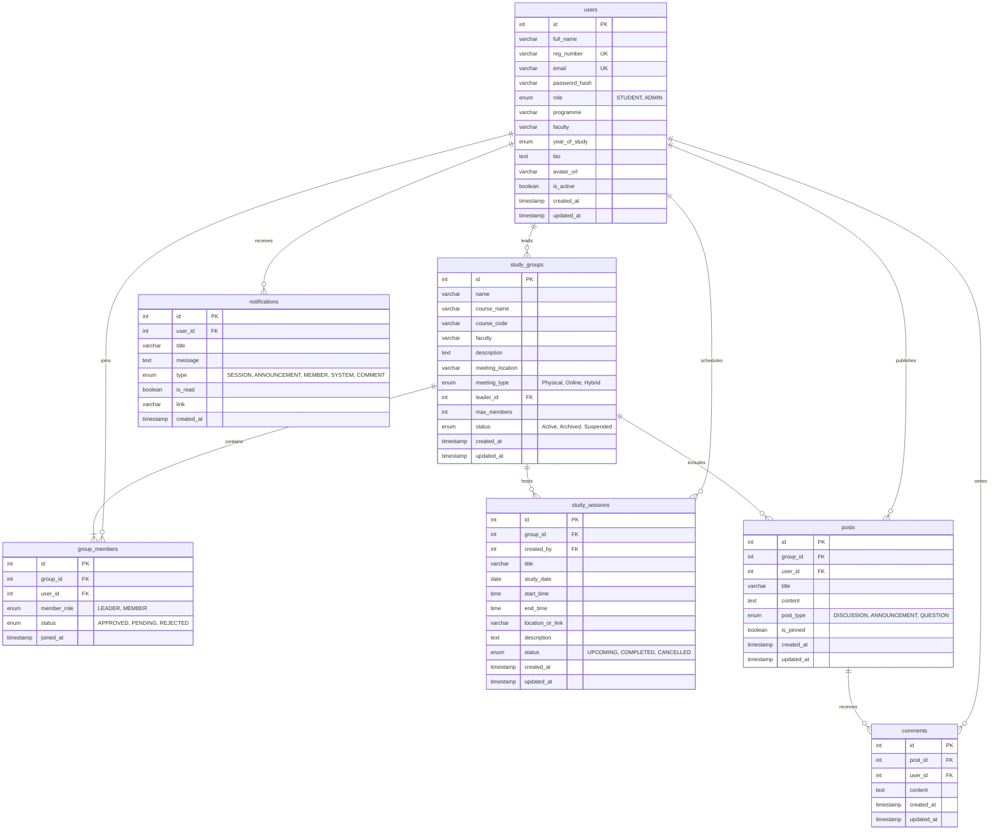

# DATABASE DESIGN & ENTITY-RELATIONSHIP DIAGRAM (ERD)

**Database Name:** `student_study_group_finder`  
**RDBMS:** MySQL 8.0+  
**Engine:** InnoDB  
**Character Set:** utf8mb4 / utf8mb4_unicode_ci  

---

## 1. Entity-Relationship Diagram (Mermaid)

---

## 2. Table Specifications & Data Dictionary

### Table 1: `users`
Represents registered students and administrative personnel at Uganda Christian University.

| Column | Data Type | Constraints | Description |
|---|---|---|---|
| `id` | `INT` | `AUTO_INCREMENT, PRIMARY KEY` | Unique surrogate key |
| `full_name` | `VARCHAR(120)` | `NOT NULL` | Student full legal name |
| `reg_number` | `VARCHAR(40)` | `NOT NULL, UNIQUE` | UCU registration number (e.g., S22/B23/BSIT/014) |
| `email` | `VARCHAR(120)` | `NOT NULL, UNIQUE` | University or student email address |
| `password_hash` | `VARCHAR(255)` | `NOT NULL` | One-way bcrypt hash (never plain text) |
| `role` | `ENUM` | `'STUDENT', 'ADMIN'`, Default `'STUDENT'` | Access control level |
| `programme` | `VARCHAR(120)` | `NOT NULL` | Academic degree (e.g., BSIT, BSCS, LLB, BBA) |
| `faculty` | `VARCHAR(120)` | `NOT NULL` | UCU Faculty / School |
| `year_of_study` | `ENUM` | `'Year 1', 'Year 2', 'Year 3', 'Year 4', 'Postgraduate'` | Current academic year |
| `bio` | `TEXT` | `NULL` | Student personal statement and study interests |
| `avatar_url` | `VARCHAR(255)` | `NULL` | Profile picture URI |
| `is_active` | `BOOLEAN` | `DEFAULT TRUE` | Account active flag for moderation |
| `created_at` | `TIMESTAMP` | `DEFAULT CURRENT_TIMESTAMP` | Account creation timestamp |
| `updated_at` | `TIMESTAMP` | `ON UPDATE CURRENT_TIMESTAMP` | Last profile update timestamp |

---

### Table 2: `study_groups`
Stores academic study circles created by course students.

| Column | Data Type | Constraints | Description |
|---|---|---|---|
| `id` | `INT` | `AUTO_INCREMENT, PRIMARY KEY` | Unique group ID |
| `name` | `VARCHAR(150)` | `NOT NULL` | Group title (e.g. Web Dev Masterminds) |
| `course_name` | `VARCHAR(150)` | `NOT NULL` | Formal course unit title |
| `course_code` | `VARCHAR(30)` | `NOT NULL` | UCU Course code (e.g. BIT3104) |
| `faculty` | `VARCHAR(120)` | `NOT NULL` | University faculty host |
| `description` | `TEXT` | `NOT NULL` | Objectives, topics covered and guidelines |
| `meeting_location` | `VARCHAR(150)` | `NOT NULL` | Physical room or online conference link |
| `meeting_type` | `ENUM` | `'Physical', 'Online', 'Hybrid'` | Meeting format |
| `leader_id` | `INT` | `NOT NULL, FOREIGN KEY (users.id)` | Creator automatically assigned as Leader |
| `max_members` | `INT` | `DEFAULT 15` | Maximum allowed capacity |
| `status` | `ENUM` | `'Active', 'Archived', 'Suspended'` | Group operating status |
| `created_at` | `TIMESTAMP` | `DEFAULT CURRENT_TIMESTAMP` | Creation date |
| `updated_at` | `TIMESTAMP` | `ON UPDATE CURRENT_TIMESTAMP` | Modification date |

---

### Table 3: `group_members`
Implements the many-to-many relationship between students and study groups. Enforces a composite unique key to guarantee a student cannot join the same group multiple times.

| Column | Data Type | Constraints | Description |
|---|---|---|---|
| `id` | `INT` | `AUTO_INCREMENT, PRIMARY KEY` | Unique membership ID |
| `group_id` | `INT` | `NOT NULL, FK (study_groups.id) ON DELETE CASCADE` | Group identifier |
| `user_id` | `INT` | `NOT NULL, FK (users.id) ON DELETE CASCADE` | Student identifier |
| `member_role` | `ENUM` | `'LEADER', 'MEMBER'`, Default `'MEMBER'` | Membership role |
| `status` | `ENUM` | `'APPROVED', 'PENDING', 'REJECTED'` | Membership status |
| `joined_at` | `TIMESTAMP` | `DEFAULT CURRENT_TIMESTAMP` | Join timestamp |
| *Constraint* | `UNIQUE KEY` | `(group_id, user_id)` | Prevents duplicate memberships |

---

### Table 4: `study_sessions`
Maintains schedule records for revision sprints.

| Column | Data Type | Constraints | Description |
|---|---|---|---|
| `id` | `INT` | `AUTO_INCREMENT, PRIMARY KEY` | Session ID |
| `group_id` | `INT` | `NOT NULL, FK (study_groups.id) ON DELETE CASCADE` | Associated group |
| `created_by` | `INT` | `NOT NULL, FK (users.id)` | Group leader who scheduled session |
| `title` | `VARCHAR(180)` | `NOT NULL` | Session title / revision agenda |
| `study_date` | `DATE` | `NOT NULL` | Calendar date of meeting |
| `start_time` | `TIME` | `NOT NULL` | Meeting start time |
| `end_time` | `TIME` | `NOT NULL` | Meeting conclusion time |
| `location_or_link` | `VARCHAR(255)` | `NOT NULL` | Campus room or Google Meet URL |
| `description` | `TEXT` | `NULL` | Revision goals and preparation tasks |
| `status` | `ENUM` | `'UPCOMING', 'COMPLETED', 'CANCELLED'` | Session status |

---

### Table 5: `posts`
Represents group communication messages, academic questions, and announcements.

| Column | Data Type | Constraints | Description |
|---|---|---|---|
| `id` | `INT` | `AUTO_INCREMENT, PRIMARY KEY` | Post ID |
| `group_id` | `INT` | `NOT NULL, FK (study_groups.id) ON DELETE CASCADE` | Target group |
| `user_id` | `INT` | `NOT NULL, FK (users.id) ON DELETE CASCADE` | Author student |
| `title` | `VARCHAR(200)` | `NOT NULL` | Post subject heading |
| `content` | `TEXT` | `NOT NULL` | Detailed message or question |
| `post_type` | `ENUM` | `'DISCUSSION', 'ANNOUNCEMENT', 'QUESTION'` | Message taxonomy |
| `is_pinned` | `BOOLEAN` | `DEFAULT FALSE` | Pinned to top of group board |
| `created_at` | `TIMESTAMP` | `DEFAULT CURRENT_TIMESTAMP` | Post timestamp |

---

### Table 6: `comments`
Threaded discussion responses linked to parent posts.

| Column | Data Type | Constraints | Description |
|---|---|---|---|
| `id` | `INT` | `AUTO_INCREMENT, PRIMARY KEY` | Comment ID |
| `post_id` | `INT` | `NOT NULL, FK (posts.id) ON DELETE CASCADE` | Target discussion post |
| `user_id` | `INT` | `NOT NULL, FK (users.id) ON DELETE CASCADE` | Author student |
| `content` | `TEXT` | `NOT NULL` | Reply message text |
| `created_at` | `TIMESTAMP` | `DEFAULT CURRENT_TIMESTAMP` | Comment timestamp |

---

### Table 7: `notifications`
Alerts and system reminders dispatched to students.

| Column | Data Type | Constraints | Description |
|---|---|---|---|
| `id` | `INT` | `AUTO_INCREMENT, PRIMARY KEY` | Notification ID |
| `user_id` | `INT` | `NOT NULL, FK (users.id) ON DELETE CASCADE` | Recipient student |
| `title` | `VARCHAR(150)` | `NOT NULL` | Notification headline |
| `message` | `TEXT` | `NOT NULL` | Notification content text |
| `type` | `ENUM` | `'SESSION', 'ANNOUNCEMENT', 'MEMBER', 'SYSTEM', 'COMMENT'` | Notification classification |
| `is_read` | `BOOLEAN` | `DEFAULT FALSE` | Read status |
| `link` | `VARCHAR(255)` | `NULL` | Deep link to target resource |
| `created_at` | `TIMESTAMP` | `DEFAULT CURRENT_TIMESTAMP` | Dispatch timestamp |

---

## 3. Relational Normalization Analysis
- **First Normal Form (1NF):** Every column contains atomic scalar values. No repeating groups or comma-separated lists exist.
- **Second Normal Form (2NF):** Every non-key attribute is fully functionally dependent on the entire primary key. In the `group_members` junction table, each attribute (`member_role`, `status`, `joined_at`) depends on the composite primary key.
- **Third Normal Form (3NF):** No transitive dependencies exist. Attributes like `faculty` and `programme` belong directly to the `users` entity without depending on other non-key attributes.
- **Referential Integrity:** `ON DELETE CASCADE` is applied to child tables (`group_members`, `posts`, `comments`, `study_sessions`, `notifications`) so that deleting a group or post automatically cleans up associated child rows without leaving orphaned records.
