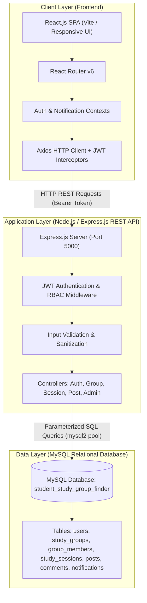

# MILESTONE ONE: CONCEPTUALIZATION & SYSTEM DESIGN

**Project Title:** Student Study Group Finder  
**Institution:** Uganda Christian University (UCU), Mukono Main Campus  
**Course:** Web and Mobile Application Development  
**Academic Year:** 2024/2025  

---

## 1. Problem Statement
Undergraduate and diploma students across the diverse faculties at Uganda Christian University (including the Faculty of Science & Technology, Faculty of Law, School of Business, and Faculty of Social Sciences) frequently face acute logistical and communicative barriers when attempting to identify peers registered in identical course units. Traditional ad-hoc methods—such as impromptu classroom announcements, fragmented WhatsApp and Telegram groups, or bulletin board notices—suffer from several critical flaws:
1. **Fragmentation and Information Decay:** Academic materials, meeting links, and revision topics shared on informal messaging platforms quickly get buried under social chatter.
2. **Duplication and Lack of Course Alignment:** Students often study in isolation or create multiple redundant revision groups for the same course unit without knowing of each other's existence.
3. **Absence of Role Accountability:** Informal study sessions frequently fail due to unclear leadership, uncoordinated meeting times, and no central repository for group schedules.
4. **Administrative Blindspots:** University departments have zero visibility into student peer learning activities, making it impossible to identify which courses have high study group activity or where additional academic support is needed.

The **Student Study Group Finder** directly resolves these challenges by providing an institutional web application that streamlines group formation, enforces academic accountability through group leadership, enables calendar-based session scheduling, and fosters moderated peer-to-peer revision.

---

## 2. Project Objectives

### 2.1 General Objective
To design, develop, and evaluate a secure, responsive, full-stack web application called **Student Study Group Finder** that empowers Uganda Christian University students to discover, create, join, coordinate, and moderate academic study groups.

### 2.2 Specific Objectives
1. **User Authentication & Role-Based Access Control:** Implement secure registration and login using institutional credentials, bcrypt password hashing, and JWT authorization for three distinct roles: Student, Group Leader, and System Administrator.
2. **Study Group Discovery & Directory:** Provide a dynamic search and multi-criteria filtering engine enabling students to locate study groups by course code (e.g., `BIT3104`), course name, faculty, and meeting format.
3. **Automated Leadership Assignment:** Engineer a business rule that automatically elevates any student who creates a study group to the role of Group Leader, granting them moderation and session scheduling privileges.
4. **Study Session Scheduling:** Enable group leaders to schedule and publish physical (e.g., Hamu Mukasa Library) and online (e.g., Google Meet) revision sessions with date, time, and location specifications.
5. **Interactive Group Communication:** Develop an integrated discussion and announcement board where members can ask academic questions, share revision notes, and post threaded comments.
6. **Administrative Analytics & Oversight:** Build an administrative control dashboard offering real-time platform metrics (total users, active groups, sessions, most active courses) and user/group moderation tools.

---

## 3. Project Scope
- **Target Audience:** Uganda Christian University undergraduate and diploma students across all faculties, group leaders, and academic administrators.
- **Functional Scope:** Student registration, profile management, study group creation, automated leader role assignment, group search and filtering, membership requests, session scheduling, discussion boards, threaded comments, unread notifications, and administrative moderation.
- **Technical Scope:** React.js frontend (SPA), Node.js and Express.js REST API backend, and MySQL 8.0 relational database with ACID consistency.
- **Exclusions:** Real-time video/audio streaming (the platform delegates live calls to external institutional meeting platforms like Google Meet and Zoom via shared links).

---

## 4. System Architecture

### 4.1 Architectural Diagram (Mermaid)



### 4.2 Architectural Diagram (Text / ASCII Representation)
```
+-------------------------------------------------------------------------------+
|                       CLIENT TIER (React.js Frontend SPA)                     |
|  - Landing Page | Registration | Login | Dashboard | Explore | Group Workspace |
|  - React Router v6 | Axios HTTP Client | Lucide Icons | Responsive UI CSS     |
+-------------------------------------------------------------------------------+
                                    |
                            HTTP / REST (JSON)
                    Authorization: Bearer <JWT Token>
                                    v
+-------------------------------------------------------------------------------+
|                      APPLICATION TIER (Node.js & Express.js)                   |
|  - Express Server (Port 5000) | CORS | Morgan Logger                           |
|  - Authentication Middleware (verifyToken, requireGroupLeader, requireAdmin)   |
|  - Controllers: AuthController, GroupController, SessionController, etc.      |
|  - Security: bcrypt password hashing, Input Validation                        |
+-------------------------------------------------------------------------------+
                                    |
                           mysql2 Connection Pool
                            Parameterized Queries
                                    v
+-------------------------------------------------------------------------------+
|                     DATABASE TIER (MySQL Relational Database)                 |
|  Database: student_study_group_finder                                         |
|  - users            (Students, Administrators)                                |
|  - study_groups     (Course groups, faculty, leader foreign key)              |
|  - group_members    (Unique composite key, role, status)                      |
|  - study_sessions   (Dates, times, locations, status)                         |
|  - posts            (Announcements, questions, discussions)                   |
|  - comments         (Threaded replies, author references)                     |
|  - notifications    (Alerts, session reminders, unread counts)                |
+-------------------------------------------------------------------------------+
```

---

## 5. Technology Selection Rationale

| Layer | Technology | Justification & Academic Rationale |
|---|---|---|
| **Frontend Framework** | **React.js 18** | Component-driven architecture allows reusable cards, modals, and tabs. Virtual DOM guarantees snappy dashboard interactions. |
| **Routing** | **React Router v6** | Declarative client-side routing with protected route guards for authentication and administrative clearance. |
| **HTTP Client** | **Axios** | Simplified request/response interceptors to automatically attach JWT Bearer tokens and gracefully intercept 401 expiration responses. |
| **Icons & Design** | **Lucide React & Custom CSS** | Lightweight vector icons; custom university-themed CSS (Royal Blue `#0B3B60`, Gold `#E09F3E`, Slate Grey `#F8FAFC`) gives a polished collegiate aesthetic without bulky external UI frameworks. |
| **Backend Runtime** | **Node.js** | Asynchronous, event-driven I/O ideal for handling concurrent REST requests from university students. |
| **Backend Framework** | **Express.js** | Unopinionated, robust REST API routing, middleware chaining for authentication/validation, and straightforward JSON payload management. |
| **Database** | **MySQL 8.0** | Industry-standard relational database management system (RDBMS) ensuring strict schema enforcement, foreign key constraints (`ON DELETE CASCADE`), transactional integrity, and normalized data models. |
| **Security** | **JWT & bcrypt** | Stateless authentication tokens prevent server-side session memory bloat; bcrypt with a work factor of 10 protects passwords against rainbow-table attacks. |
| **Development Tools**| **VS Code & Git** | Standardized IDE environment with modular Git branches for multi-student collaboration. |
