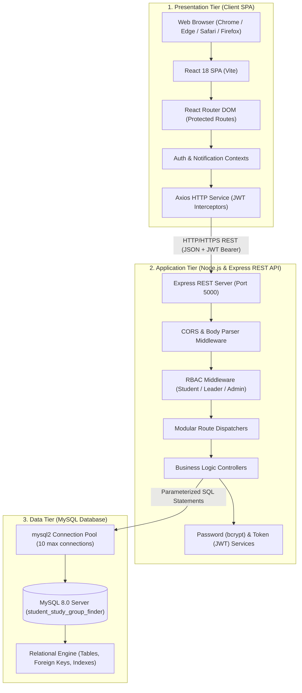

# SYSTEM ARCHITECTURE SPECIFICATION

**Project Title:** Student Study Group Finder  
**Target Institution:** Uganda Christian University (UCU)  
**Academic Program:** Bachelor of Science in Information Technology / Diploma in IT  
**Course Unit:** Web and Mobile Application Development  

---

## 1. Architectural Style
The **Student Study Group Finder** adheres to a decoupled **Three-Tier Client-Server Architecture** utilizing a **RESTful Application Programming Interface (API)**. This separation enables:
- Independent scalability and deployment of frontend and backend services.
- Future expansion to native mobile clients (React Native / Android) consuming the same RESTful endpoints.
- Isolated security perimeters with stateless token verification.

---

## 2. Structural Layer Decomposition

---

## 3. Component Interactions & Data Flow

### 3.1 Authentication & Authorization Flow
1. **Credentials Dispatch:** The client submits `email` (or `reg_number`) and `password` to `POST /api/auth/login`.
2. **Password Verification:** The backend retrieves the user record by matching the identifier using parameterized SQL. `bcrypt.compare` checks the plain-text password against the stored bcrypt hash.
3. **Token Generation:** Upon successful verification, the backend generates a signed JSON Web Token (JWT) containing `{ id, email, role }` signed with `JWT_SECRET` and a 7-day expiration.
4. **Client Persistence:** The React client stores the token in `localStorage` and sets default authorization headers in Axios.
5. **Route Protection:** When navigating to protected routes (e.g. `/dashboard` or `/admin`), React Route Guards verify token presence. Subsequent API calls attach `Authorization: Bearer <token>`, which Express middleware parses and validates.

### 3.2 Study Group Creation & Automatic Leader Assignment Flow
1. Student fills group details on `CreateGroupPage.jsx` (`name`, `course_code`, `faculty`, `description`, `meeting_location`, `meeting_type`).
2. Frontend dispatches `POST /api/groups` with JWT Bearer token.
3. `groupController.createGroup` extracts `leaderId = req.user.id`.
4. In an atomic transaction, the group is saved to `study_groups`, and a record is immediately created in `group_members` assigning `member_role = 'LEADER'` and `status = 'APPROVED'`.
5. An initial welcoming announcement is posted to the group discussion feed.
6. The frontend receives HTTP 201 with the new `groupId` and redirects the student to the active group workspace.

### 3.3 Study Session Scheduling & Member Notification Flow
1. Group Leader accesses the group workspace and submits a session scheduling form (`title`, `study_date`, `start_time`, `end_time`, `location_or_link`).
2. `sessionController.createSession` checks that `req.user.id === study_groups.leader_id`.
3. The session is saved to `study_sessions`.
4. The system queries `group_members` for all approved students enrolled in that group.
5. An automated notification record (`type: 'SESSION'`) is inserted into `notifications` for each group member.
6. Members see the new session on their personal dashboards and receive notification badges.

---

## 4. Security Principles Applied
- **Defense in Depth:** Dual-layer validation at both the frontend (client form validation) and backend (controller assertions).
- **Principle of Least Privilege:** Students cannot access administrative controls; non-leaders cannot edit or schedule sessions for groups they do not lead.
- **Data Protection at Rest & Transit:** Passwords hashed with bcrypt; parameterized SQL eliminates SQL injection; HTTPS-ready REST endpoints.
